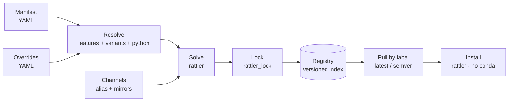

# nepenthe

> _Forget your environment sorrows._

nepenthe builds, versions, and distributes large shared conda and PyPI
environments. You describe an environment once in a declarative manifest, solve
it with [rattler](https://github.com/conda/rattler), and publish the resulting
lockfile to a versioned registry. Other machines install the packages recorded
in the lock without re-solving.

This wiki is the user guide. For how nepenthe is built internally, see the
[Architecture](Architecture) page under Contributing.

## Quickstart

Create a manifest with the dependencies and version constraints you need:

```yaml
# environment.yaml
project:
  name: demo
  channels: [conda-forge]
  platforms: [linux-64]
  python: ["3.11"]

dependencies:
  - numpy >=2
  - pip

environments:
  app: []
```

```bash
# solve once → a fully-pinned, reproducible lock
nepenthe build --manifest environment.yaml --env app --output-dir .
# → app-py3.11.lock

# render the lock as a conda `@EXPLICIT` spec, for conda/mamba users
nepenthe export --env app --lock app-py3.11.lock --platform linux-64 -o app.txt
# → app.txt

# install it — with conda from the spec, or with nepenthe (no conda) from a registry
conda create --name app --file app.txt
```

The lock can be published to a registry for nepenthe consumers or exported as
an `@EXPLICIT` spec for conda users.

## What problem does it solve?

Sharing an environment across repos and machines requires consistent package
versions, independent releases, and access to package servers. nepenthe stores
each environment as a versioned artifact:

| Requirement                          | nepenthe behavior                                                                 |
| ------------------------------------ | --------------------------------------------------------------------------------- |
| The same package versions everywhere | Installs use the packages recorded in a hashed lock                               |
| Independent release schedules        | Each environment has its own semver versions                                      |
| Your own package servers             | Channels resolve to configurable URLs, including Artifactory servers              |
| Private packages without leaks       | Credentials injected at use time from an auth store; never written into artifacts |
| Release integrity                    | Immutable, content-addressed locks; pulls are integrity-checked                   |

## How it fits together



1. Write a [manifest](Manifests) with features, environments, variants, and
   package channels.
1. Add an [overrides](Manifests#override-layers) file to pin versions or
   set variant constraints without editing the manifest.
1. Configure channels to use your package servers. See
   [Channels & Artifactory](Channels).
1. Solve the environment and export a lock.
1. Publish the lock to a [registry](Registry) and resolve it later by label
   (`latest`, `latest-but-one`, an exact version, or a semver range).
1. Install from the lock into a prefix without conda. See
   [Installing Environments](Install).

## Status

nepenthe supports manifest composition, override layers, solving with rattler,
lock and compatibility exports, and versioned registries on `file://`, `s3://`,
and `https://` backends. It can solve multiple platforms from one host into a
single lock and install packages without conda. The CLI includes `diff`,
`status`, `remove`, and `activate` commands.

Use nepenthe as a Rust library, through the CLI, or from Python bindings that
mirror the CLI. See [Installation](Installation).

## Further reading

- [Motivation](Motivation): the problem and alternatives.
- [Concepts](Concepts): terminology.
- [Manifests](Manifests): define an environment.
- [Channels & Artifactory](Channels): configure package servers.
- [Registry & Versioning](Registry): publish and resolve versions.
- [Installing Environments](Install): install into a prefix.
- [Consuming in a Project](Projects): use a shared environment in a repo.
- [Packing](Packing): transfer environments to air-gapped hosts.
- [Python API](Python-API): use nepenthe from Python.
- [Storage Backends](Backends): store specs and locks.
- [Contributing](Contribute): contribute to nepenthe.
